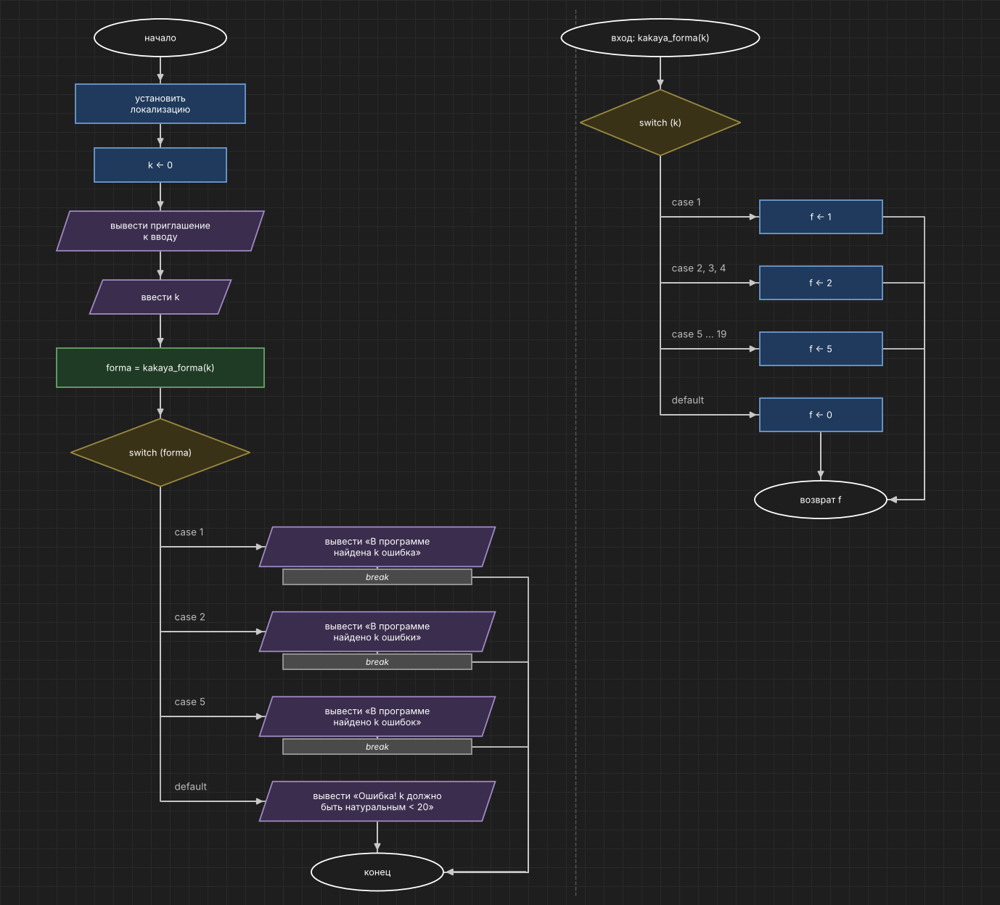

# Домашнее задание к работе 7

## Вариант 14

## Условие задачи

Для натурального числа k (k<20) напечатать фразу «в программе найдено k ошибок», согласовав окончание слова «ошибка» с числом k. Использовать конструкцию if-else недопустимо.

## 1. Алгоритм и блок-схема

### Алгоритм

1. Начало.
2. Установить локализацию.
3. Присвоить `k = 0` (если ввод будет неправильный, в `k` останется 0 и программа выдаст ошибку).
4. Вывести приглашение к вводу и ввести `k` — количество ошибок.
5. Вызвать функцию `forma = kakaya_forma(k)` и сохранить результат. Выбор по значению `k`:
   - 1 → `f = 1` («ошибка»);
   - 2, 3, 4 → `f = 2` («ошибки»);
   - от 5 до 19 → `f = 5` («ошибок»);
   - любое другое значение → `f = 0` (k неправильное).
6. Выбор по значению `forma`:
   - 1 → вывести «В программе найдена k ошибка»;
   - 2 → вывести «В программе найдено k ошибки»;
   - 5 → вывести «В программе найдено k ошибок»;
   - иначе → вывести сообщение об ошибке.
7. Конец.

### Блок-схема



## 2. Реализация программы

```c
#define _CRT_SECURE_NO_WARNINGS
#include <stdio.h>
#include <locale.h>

int kakaya_forma(int k);

int main()
{
    int k = 0;
    int forma;

    setlocale(LC_ALL, "Rus");

    printf("Введите количество ошибок k (от 1 до 19): ");
    scanf("%d", &k);

    forma = kakaya_forma(k);

    switch (forma)
    {
    case 1:
        printf("В программе найдена %d ошибка\n", k);
        break;
    case 2:
        printf("В программе найдено %d ошибки\n", k);
        break;
    case 5:
        printf("В программе найдено %d ошибок\n", k);
        break;
    default:
        printf("Ошибка! k должно быть натуральным числом меньше 20\n");
    }

    return 0;
}

/* возвращает форму слова: 1 - «ошибка», 2 - «ошибки», 5 - «ошибок», 0 - если k неправильное */
int kakaya_forma(int k)
{
    int f;

    switch (k)
    {
    case 1:
        f = 1;
        break;
    case 2: case 3: case 4:
        f = 2;
        break;
    case 5: case 6: case 7: case 8: case 9: case 10: case 11: case 12:
    case 13: case 14: case 15: case 16: case 17: case 18: case 19:
        f = 5;
        break;
    default:
        f = 0;
    }

    return f;
}
```

## 3. Результаты работы программы

```
Введите количество ошибок k (от 1 до 19): 1
В программе найдена 1 ошибка

Введите количество ошибок k (от 1 до 19): 3
В программе найдено 3 ошибки

Введите количество ошибок k (от 1 до 19): 5
В программе найдено 5 ошибок

Введите количество ошибок k (от 1 до 19): 11
В программе найдено 11 ошибок

Введите количество ошибок k (от 1 до 19): 19
В программе найдено 19 ошибок

Введите количество ошибок k (от 1 до 19): 20
Ошибка! k должно быть натуральным числом меньше 20

Введите количество ошибок k (от 1 до 19): 0
Ошибка! k должно быть натуральным числом меньше 20

Введите количество ошибок k (от 1 до 19): abc
Ошибка! k должно быть натуральным числом меньше 20
```

## 4. Информация о разработчике

Кочергин Савелий, группа бИД-261
